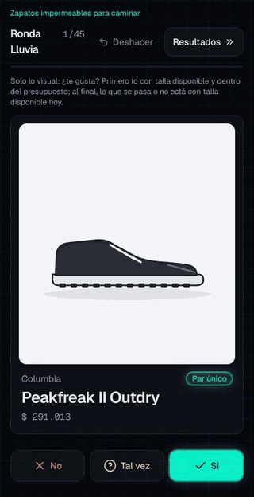
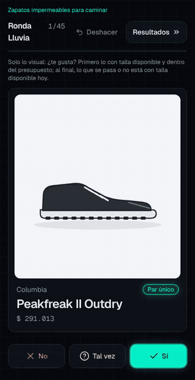

# decision-deck

**Deja de darle vueltas a "¿cuál compro?".** Un kit para decidir una compra con agentes de IA:
primero fijas los criterios, los agentes investigan con fuentes, auditas lo que encontraron y decides
en dos pasos: *¿me gusta?* (deslizar) y *¿me conviene?* (radar, tier list, precio contra valor).

**[Demo en vivo](https://decision-deck-kit.vercel.app)** · [Read in English](README.md) · [Caso de estudio](docs/caso-de-estudio.md)

<p>
  
  
</p>

## Qué problema resuelve

Demasiadas pestañas, reseñas que se contradicen, precios sin disponibilidad y ningún criterio para
pesarlo todo. Casi nunca falta información: lo difícil es decidir. decision-deck lo vuelve un método:

```
criterios → investigación con agentes → auditoría → datos con fuente → deslizar (¿me gusta?) → radar y ranking (¿me conviene?)
```

Tiene dos mitades:

| Mitad | Qué es | Para quién |
|---|---|---|
| **Método** (`skills/`, `AGENTS.md`) | Skills de Claude Code que guían cada paso: entrevista de criterios, investigación, auditoría, compilación | Quien usa Claude Code, Cursor, Codex u otro agente |
| **App plantilla** (`src/`) | Una web estática que lee `decision.config.json` y los datos compilados. No tiene ninguna categoría escrita en el código | Quien quiere ver y decidir |

## Inicio en 3 pasos

1. **Clona** e instala:
   ```
   git clone https://github.com/diegoalberto0104/decision-deck.git && cd decision-deck && npm install
   ```
2. **`/criterios`** en Claude Code: una entrevista de una pregunta a la vez (uso real, presupuesto
   ideal y techo, innegociables, ejes que importan). Escribe `decision.config.json`.
3. **`/investigar`**: los agentes investigan un segmento cada uno y escriben `data/<segmento>.json`,
   con fuente y fecha para cada precio y cada nota.

Después `/auditar` (modelos que no existen, claims sin fuente, precios sin disponibilidad) y
`/compilar`, y `npm run dev`. Primero deslizas; los números vienen después.

¿Sin agente? Cada skill es un Markdown en `skills/`: léelo y síguelo, o apunta cualquier agente a
[`AGENTS.md`](AGENTS.md).

**¿Solo quieres verlo?** `npm install && npm run dev` abre el ejemplo (zapatos impermeables para
caminar). `npm run data:audifonos && npx vite` abre el segundo (audífonos con cancelación de ruido).

## Cómo funciona el método

| Paso | Skill | Entrega |
|---|---|---|
| 1. Criterios | [`criterios`](skills/criterios/SKILL.md) | `decision.config.json`: presupuesto, segmentos, ejes y pesos, innegociables, insignias |
| 2. Investigación | [`investigar`](skills/investigar/SKILL.md) | `data/*.json`: ítems, fichas, notas 1–5 con fuente, ofertas con precio final y disponibilidad |
| 3. Auditoría | [`auditar`](skills/auditar/SKILL.md) | `data/auditoria.md`: hallazgo, riesgo y acción por cada problema |
| 4. Compilación | [`compilar`](skills/compilar/SKILL.md) | `public/data/datos.json`, validado contra el JSON Schema |

Luego la app:

- **Deslizar**: una tarjeta a la vez (imagen, modelo, precio). Sí, No o Tal vez, solo lo visual.
  Primero lo disponible y dentro del presupuesto; al final lo demás, con su etiqueta.
- **Resultados**: una recomendación calculada, pesos ajustables y comparación de hasta 3 ítems en un
  radar, con el mejor valor de cada fila resaltado.
- **Ranking**: tier list por puntaje total o por cualquier eje, y un gráfico de precio contra valor
  con la frontera de mejor valor.
- **Tiendas**: dónde se buscó, qué bloqueó y un formulario para sugerir tiendas.

Todo lo propio de la categoría vive en [`decision.config.json`](schema/config.schema.json) (moneda,
presupuesto, segmentos, ejes, innegociables, insignias, palabras de la interfaz).
`npm run check:dominio` comprueba que `src/` y `scripts/` sigan siendo genéricos.

## Límites y ética de la investigación

- **Una nota sin fuente se muestra vacía.** Un hueco honesto vale más que un número inventado.
- **Solo precio final**: con envío, impuestos y comisión de la tarjeta, en tu moneda.
- **Investigación despacio y respetuosa.** Sin saltarse protecciones antibot ni captchas, sin cuentas
  falsas, sin iniciar sesión. Si una tienda bloquea, se anota y se sigue. Una tienda solo cuenta como
  bloqueada después de probarla en un navegador real.
- **Sin fotos de tiendas en el repo** (derechos de autor). `public/img/` está en `.gitignore`; los
  ejemplos usan ilustraciones SVG propias. En tu equipo puedes descargar imágenes para tu uso.
- **El agente hace borradores; decides tú.** La auditoría existe porque lo que produce un agente es un
  borrador hasta que se verifica contra la fuente. Precios y stock cambian: revisa antes de comprar.
- El ejemplo de audífonos sale de una **investigación breve en la web** (reseñas de RTINGS, precios de lista y citados por medios, octubre de 2026): el stock no se leyó en las tiendas.
- La interfaz viene en español e inglés: pon `"idioma": "en-US"` en la config. Tus datos (nombres, beneficios, contras) se muestran tal como están escritos.

## Comandos

```
npm run dev              # compila los datos y abre la app
npm run data             # valida y compila (config de la raíz o el ejemplo por defecto)
npm run data -- --config examples/audifonos/decision.config.json
npm run build            # datos + tipos + build de producción
npm run check:dominio    # cero palabras de la categoría en src/ y scripts/
npm run check:privado    # cero datos personales (términos de terminos.privados.local o del secret PRIVADO_TERMINOS)
npm run check:ejemplos   # build con cada ejemplo
```

## Proponer una categoría

¿Tienes una decisión de compra que sería un buen ejemplo? [Abre un issue](https://github.com/diegoalberto0104/decision-deck/issues/new?template=proponer-categoria.md).

## Licencia

[MIT](LICENSE)
